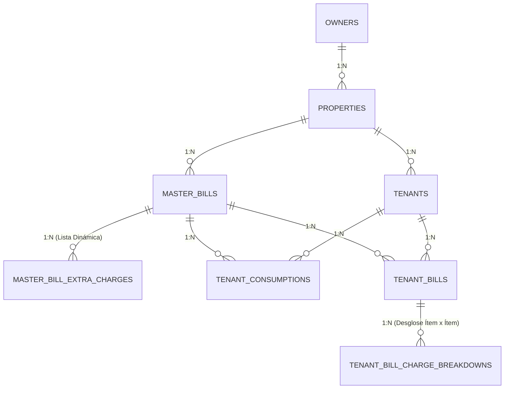

# Documentación Arquitectónica: Mi Recibo

Este documento describe las decisiones de arquitectura, diseño del modelo de datos, algoritmos de cálculo, garantías transaccionales y protocolo MCP del backend **Mi Recibo**.

---

## 1. Principios de Arquitectura

El backend sigue los principios de **Clean Architecture** (Arquitectura Limpia) adaptados a la estructura idiomática de Go (*Standard Go Project Layout*):

```
                      ┌───────────────────────────┐
                      │    Cmd (api/main, mcp)    │
                      └─────────────┬─────────────┘
                                    │
                                    ▼
       ┌────────────────────────────┴───────────────────────────┐
       │                 Handler Layer (HTTP / MCP)             │
       │   - Controllers REST (Chi)      - Tools MCP (mcp-go)   │
       │   - DTOs & JSON Serialization   - Context Extraction   │
       └────────────────────────────┬───────────────────────────┘
                                    │
                                    ▼
       ┌────────────────────────────┴───────────────────────────┐
       │                    Service Layer                       │
       │   - BillingService              - PropertyService      │
       │   - TenantService               - Anomaly Orchestration│
       └──────────────────┬───────────────────────┬─────────────┘
                          │                       │
                          ▼                       ▼
┌─────────────────────────┴─────────┐   ┌─────────┴─────────────┐
│           Domain Layer            │   │   Repository Layer    │
│  - Pure Entities (MasterBill, etc)│   │  - PostgreSQL (pgxpool│
│  - Calculator (Pure Functions)    │   │  - ACID Transactions  │
│  - Business Errors & Constants    │   │  - Batch SQL Inserts  │
└───────────────────────────────────┘   └───────────────────────┘
```

### Reglas de Dependencia:
1. **El Dominio (`internal/domain`) no depende de nada externo**: No importa base de datos, enrutador HTTP ni frameworks. Contiene structs, tipos y la matemática pura de cálculo (`CalculateBills` y `CalculateConsumptionVariation`).
2. **Los Repositorios (`internal/repository/postgres`) implementan la persistencia**: Usan `pgxpool.Pool` y `pgx.Tx` directamente con SQL nativo tipado, garantizando máxima velocidad, cero sobrecosto de ORM y control total de transacciones.
3. **Los Servicios (`internal/service`) orquestan los casos de uso**: Coordinan la obtención de datos, invocan la lógica del dominio y persisten los resultados.
4. **Los Controladores (`internal/handler`) solo adaptan protocolos**:
   - `handler/http`: Atiende peticiones HTTP REST y produce JSON.
   - `handler/mcp`: Atiende llamadas JSON-RPC sobre stdio para clientes de Inteligencia Artificial.

---

## 2. Modelo de Datos Relacional (PostgreSQL)

### 2.1 Diagrama Entidad-Relación



### 2.2 Decisiones de Diseño en BD:
1. **Precisión Financiera**:
   - Para tarifas y consumos: `NUMERIC(14, 4)` para evitar pérdidas de precisión en lecturas con decimales o precios fraccionarios por kWh / m³.
   - Para montos finales en moneda: `NUMERIC(12, 2)` con redondeo bancario estándar.
2. **Integridad y Restricciones Únicas (Constraints)**:
   - `uq_property_service_period (property_id, service_type, billing_year, billing_month)`: Impide registrar por error dos recibos de Luz en la misma casa para el mismo mes.
   - `uq_master_bill_tenant (master_bill_id, tenant_id)`: Garantiza que solo exista una lectura de consumo por inquilino en cada recibo.
   - `uq_tenant_bill_master_tenant (master_bill_id, tenant_id)`: Asegura que un inquilino solo reciba un recibo por liquidación.
3. **Borrado en Cascada (`ON DELETE CASCADE`)**:
   - Si se elimina un recibo principal, sus cargos extras, lecturas y liquidaciones asociadas se limpian automáticamente de forma consistente.

---

## 3. Algoritmo de Prorrateo y Liquidación

### 3.1 Consumo Propio Estricto (Aislado)
- Cada inquilino paga **estrictamente su consumo medido**:
  $$\text{Costo Consumo Propio}_i = \text{unidades consumidas}_i \times \text{precio unitario}$$
- **Aislamiento**: Si la suma de consumos individuales no coincide con el consumo del recibo principal (por ejemplo por luces exteriores o bombeo común), **no se cobra ni se reparte a los inquilinos**. La métrica se almacena para control administrativo del dueño.

### 3.2 Lista Dinámica de Cargos Extras
Un recibo puede incluir $M$ cargos adicionales. Para cada cargo extra $k$ en la lista:
$$\text{Cuota Inquilino}_k = \frac{\text{amount}_k}{N}$$
donde $N$ es la cantidad de inquilinos activos asociados a la propiedad.

El total de cargos extras para el inquilino es:
$$\text{Total Cargos Inquilino} = \sum_{k=1}^M \text{Cuota Inquilino}_k$$

El total final facturado al inquilino es:
$$\text{Total Inquilino}_i = \text{Costo Consumo Propio}_i + \text{Total Cargos Inquilino}$$

### 3.3 Garantía Transaccional (`pgx.Tx`)
La liquidación completa se realiza dentro de una única transacción ACID:
1. Se limpia cualquier cálculo previo si se estuviera reliquidando.
2. Se insertan en lote los `tenant_bills`.
3. Se insertan en lote los desgloses en `tenant_bill_charge_breakdowns`.
4. Se actualiza el estado del recibo principal a `CALCULATED`.
5. Se hace `Commit`. Si algún paso falla, se ejecuta `Rollback` y la base de datos queda inalterada.

---

## 4. Detección de Sobreconsumo (Spike Alert)

Al subir las unidades consumidas del mes para un inquilino:
1. El sistema consulta el consumo del mes anterior ($t-1$) para el mismo inquilino y servicio.
2. Si existe registro previo y $\text{Consumo}_{t-1} > 0$:
   $$\text{Variación \%} = \frac{\text{Consumo}_t - \text{Consumo}_{t-1}}{\text{Consumo}_{t-1}} \times 100$$
3. Si $\text{Variación \%} > \text{Umbral}$ (configurable por variable `CONSUMPTION_ALERT_SPIKE_THRESHOLD`, por defecto $20.0\%$):
   - Se marca `alert_spike = true`.
   - Se genera el mensaje explicativo:
     *"El consumo aumentó un 33.33% respecto al mes anterior (de 60.00 a 80.00 unidades)."*

---

## 5. Integración con Inteligencia Artificial (MCP)

El servidor MCP (`cmd/mcp/main.go`) expone el sistema a agentes de IA usando el protocolo estándar de Anthropic/OpenAI sobre **Standard I/O (stdio)**.

### Herramientas Expuestas:
| Herramienta | Parámetros | Utilidad |
|---|---|---|
| `list_properties` | `owner_id` | Lista las casas de un dueño. |
| `list_tenants` | `property_id` | Lista los inquilinos y su estado. |
| `get_master_bill` | `master_bill_id` | Muestra tarifa, unidades y lista de cargos extras. |
| `record_tenant_reading` | `master_bill_id`, `tenant_id`, `consumed_units` | Sube lectura y reporta si hubo alerta de sobreconsumo. |
| `calculate_master_bill` | `master_bill_id` | Ejecuta la liquidación de la casa. |
| `get_tenant_bill` | `tenant_bill_id` | Muestra recibo con desglose detallado para el inquilino. |
| `get_tenant_history` | `tenant_id` | Historial de consumos y recibos de un inquilino. |
